

# ✍️ WebNovel Assistant

**[English](#english)** | **中文**

为网络小说与故事创作者打造的 Obsidian 一站式写作套件。 
字数统计与目标追踪 · 连续原稿写作 · 作品历程与章节快照 · 时间线与伏笔 · 设定速查与图谱。

 

<a href="doc/USER_GUIDE.md"><kbd>📖 使用指南</kbd></a>
<a href="doc/OBS_OVERLAY_CSS_GUIDE.md"><kbd>🎥 OBS CSS 指南</kbd></a>
<a href="doc/CHANGELOG.md"><kbd>📋 更新日志</kbd></a>

 

<kbd>💖 支持项目 · 请作者喝杯咖啡</kbd>

 

如果这个插件对你的码字事业有所帮助，欢迎支持作者，你的支持是我持续更新的最大动力！

 

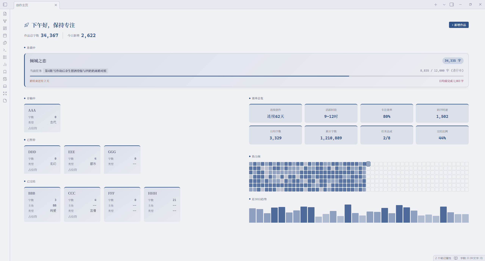

 

## ✨ 功能一览

### 🏠 创作主页
全宽仪表盘 · 动态欢迎语 · 作品总览 · 数据面板 · 一键新建与导入作品

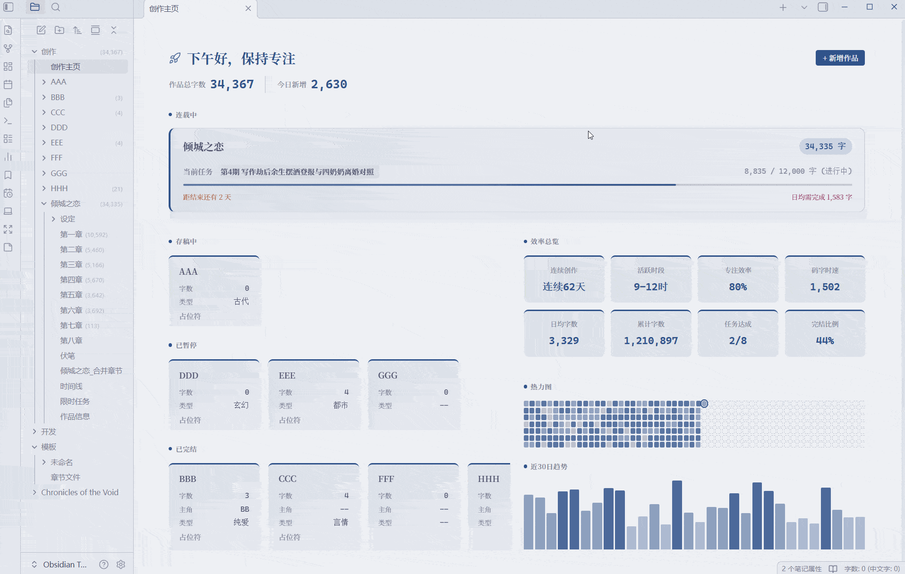

### 🗂️ 写作工作台
全章节面板 · 时间轴看板 · 伏笔看板 · 设定看板 · 任务看板 · 写作历程 
六类视图可按需显示；写作历程记录作品与章节变化，支持筛选、排序、跳转及章节状态字数快照，不补写开始记录前的历史

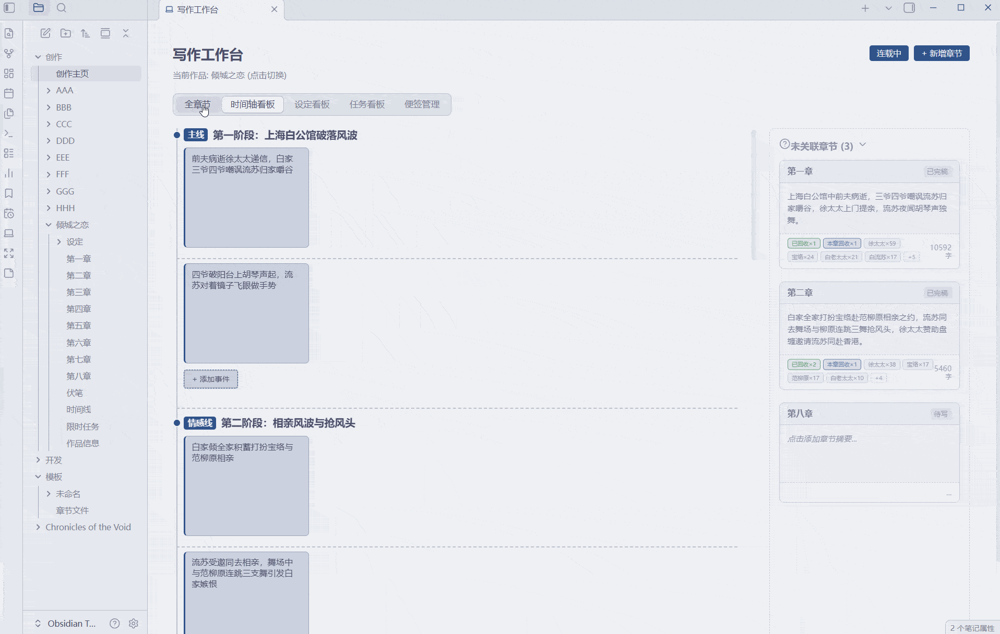

### 🌑 沉浸写作模式
桌面端全屏专注 · 打字机滚动与行淡化 · 可配置仪表盘 · 四区域辅助面板与参考文档 
原稿模式支持连续浏览章节，点击正文切换到原生编辑器继续写作，按作品记忆光标与浏览位置；章节状态辅助面板方便随时查看与编辑章节资料

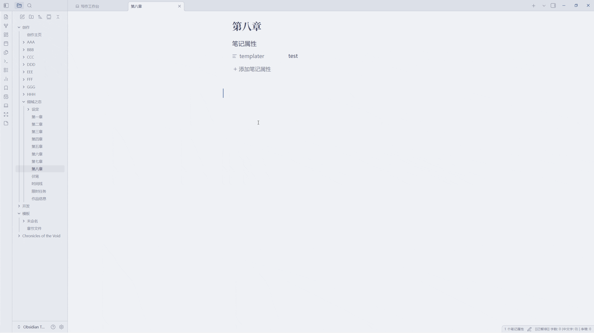

### 📊 字数统计与目标追踪
3种字数统计模式 · 多向目标追踪 · 严格章节模式 · 选区字数提示 · 章节排除统计 · 文件夹字数显示

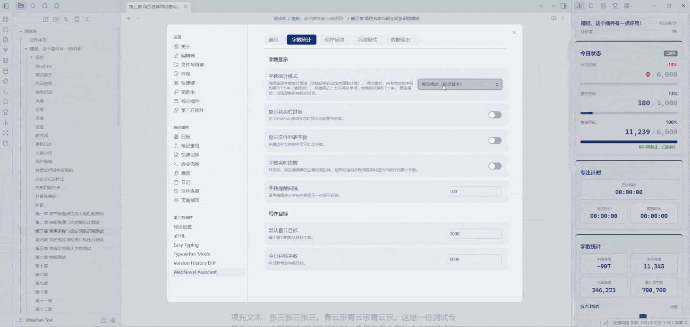

### ⏱️ 专注时间追踪
按工作区识别专注与摸鱼 · 热力图与写作趋势 · 效率统计 · 单日活跃时段与时速详情

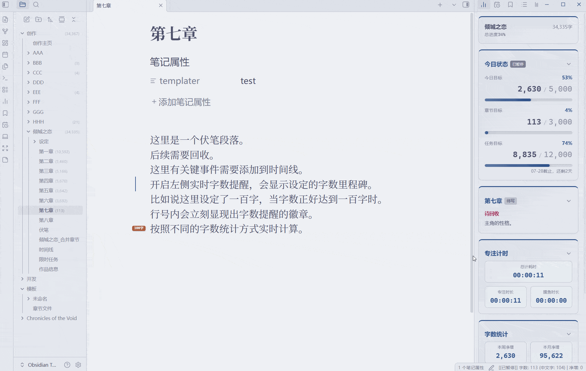

### 🕰️ 章节快照与回放
对比当前稿与本机 Obsidian 文件恢复快照 · 逐版回放与 1x / 3x / 5x 倍速 · 暂停回放后导出完整 Markdown，或经确认与备份后恢复所选快照 
需启用核心插件「文件恢复」；快照受本机保留期限限制，不随插件数据同步，也不是完整按键记录

### 🔍 校对
完全本地的编辑器内联检查 · 错词与敏感词 · 近义词一致性 · 中英文语境标点 · 可选“的/地/得”规则 · 建议卡片与确认后单处替换 · 单处/整词忽略及记录恢复

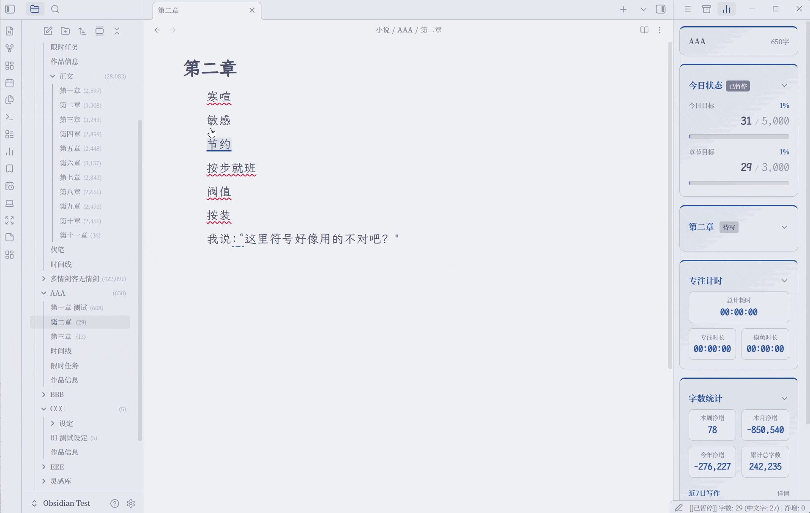

### 📝 创作辅助工具

<table>
<tr>
<td width="33%" align="center" valign="top">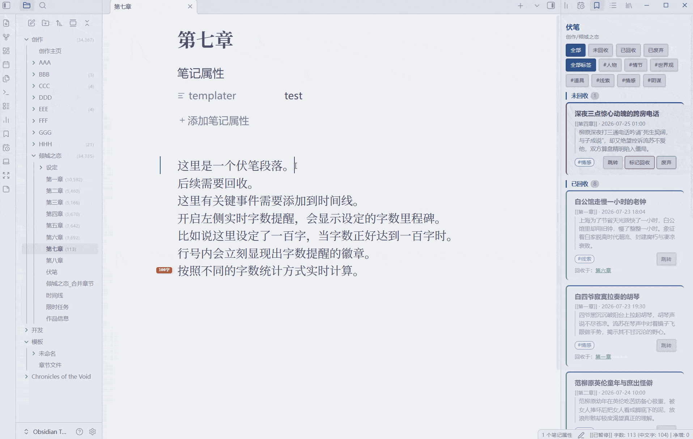 <b>伏笔管理</b> 标注 → 阶段推进 → 彻底回收</td>
<td width="33%" align="center" valign="top">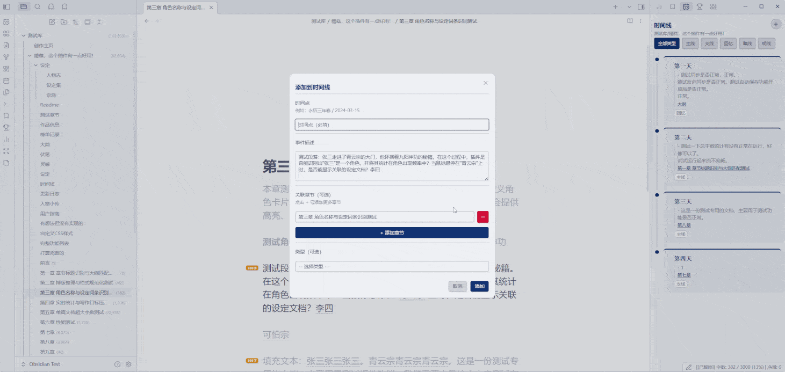 <b>时间线系统</b> 事件记录、多章节关联、类型分类</td>
<td width="33%" align="center" valign="top">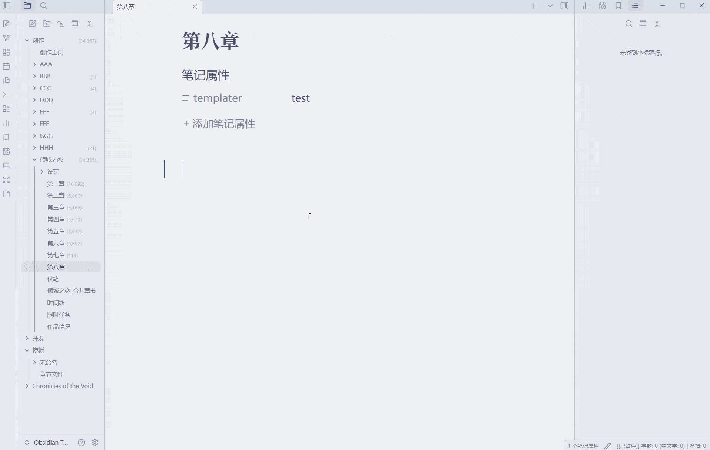 <b>章节一览</b> 卡片式展示、状态标记、摘要编辑</td>
</tr>
<tr>
<td width="33%" align="center" valign="top">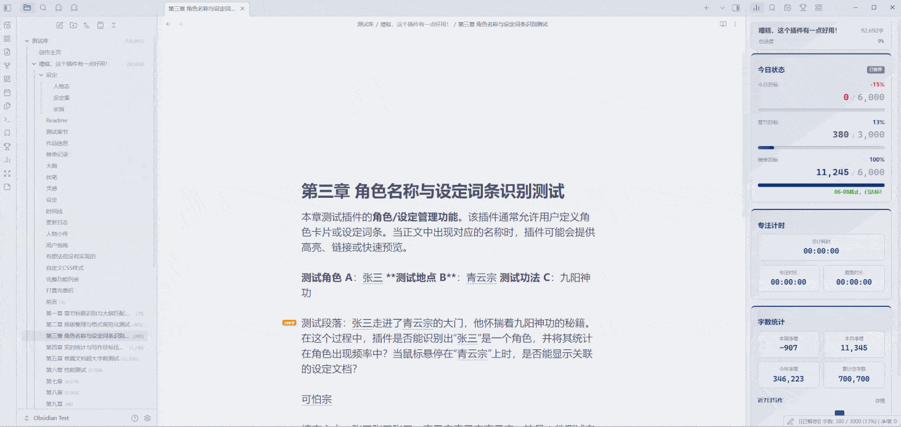 <b>设定速查与图谱</b> 嵌套目录、单文件词条、自动标注与关系图谱</td>
<td width="33%" align="center" valign="top">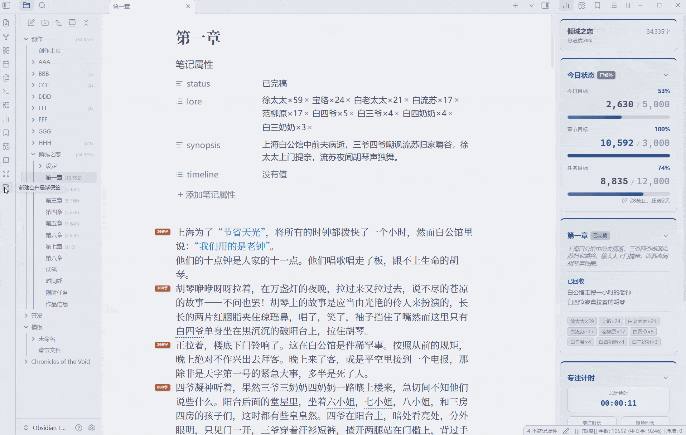 <b>悬浮便签</b> 自动保存、Markdown渲染</td>
<td width="33%" align="center" valign="top">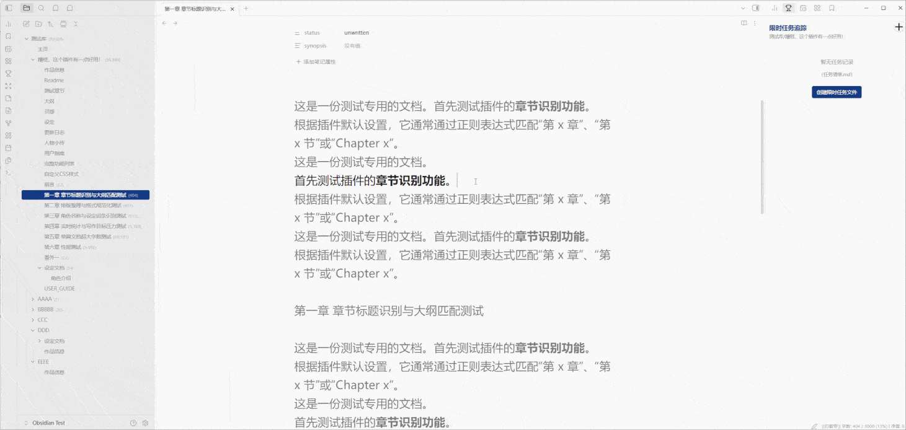 <b>任务追踪</b> 创建周期任务、支持自主放弃</td>
</tr>
<tr>
<td width="33%" align="center" valign="top">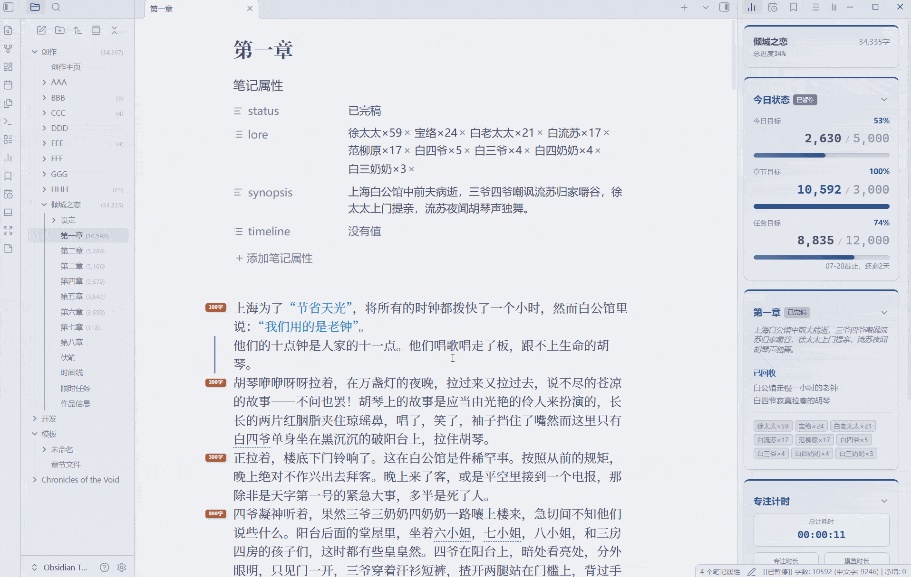 <b>高级搜索</b> 支持当前书籍、全局、自定义，快速跳转</td>
<td width="33%" align="center" valign="top">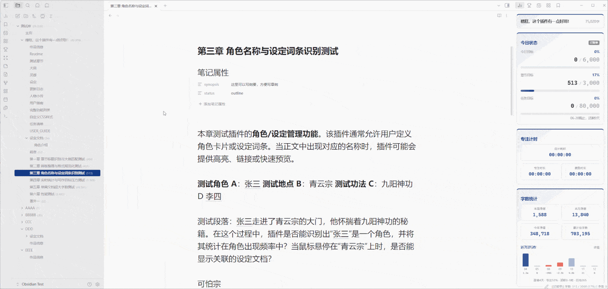 <b>合并章节</b> 桌面预览修订 · 移动端预览导出</td>
<td width="33%" align="center" valign="top">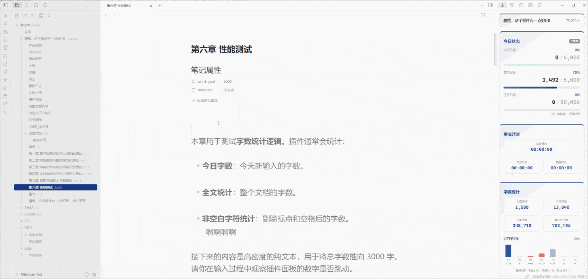 <b>智能创建与拆分章节</b> 智能递增 · 光标拆分 · 章节模板</td>
</tr>
</table>

### 🎥 OBS直播叠加层 & 📱 移动端

| 🎥 OBS叠加层 | 📱 移动端 |
|:---|:---|
| 实时显示写作数据 | 浮动字数统计与专注计时小窗 |
| 自定义样式、透明度、内容 | 贴边吸附与自动收起手柄模式 |
| 本机 HTTP 数据接口，无需统计中间文件 | **复制本文档纯净文本** — 全平台可用，尤其适合移动端长文 |

 

## 📥 安装

需要 Obsidian 1.8.7 或更高版本。

| 方式 | 步骤 |
|:-----|:-----|
| **社区插件市场** *(推荐)* | 设置 → 第三方插件 → 浏览 → 搜索 **"WebNovel Assistant"** → 安装 → 启用 |
| **BRAT** | 安装 [BRAT](https://github.com/TfTHacker/obsidian42-brat) → 添加仓库 `HatanoChihiro/obsidian-webnovel-assistant` → 启用 |
| **手动安装** | 从 [Releases](https://github.com/HatanoChihiro/obsidian-webnovel-assistant/releases) 同一版本下载 `main.js`、`manifest.json`、`styles.css` → 放入 `.obsidian/plugins/web-novel-assistant/` → 重载后启用 |

## 🚀 快速开始

1. **确认工作区**：多部作品放在 `小说/` 等总目录下时，将其填入工作区设置，一行一个目录；希望作用于全库时留空。
2. **准备作品**：在文件浏览器右键第一项工作区文件夹新增或导入作品；已有作品可直接打开章节，并按指南配置作品信息与设定。
3. **开始写作**：桌面状态栏查看字数；执行 **设定本章目标字数** 设置目标，打开 **写作工作台** 管理章节与资料。
4. **按需开启**：排版、校对、普通编辑打字机滚动与移动端浮窗默认关闭；可用设置页搜索定位选项。桌面端还可进入沉浸模式。

<kbd>🎯 主要命令</kbd>

| 命令 | 说明 |
|------|------|
| 进入/退出 沉浸写作模式 | 切换全屏沉浸创作环境 |
| 打开/关闭写作实时状态面板 | 详细统计和历史图表 |
| 打开/关闭伏笔面板 | 管理伏笔标注和回收 |
| 打开/关闭时间线面板 | 管理故事时间线 |
| 打开写作工作台面板 | 管理章节、时间线、伏笔、设定、任务和写作历程看板 |
| 打开章节一览 | 卡片式展示章节纲要 |
| 开始/暂停 专注时间统计 | 切换专注/摸鱼计时 |
| 标注为伏笔 | 将选中文字标注为伏笔 |
| 新建空白悬浮便签 | 创建浮动便签 |
| 高级搜索 | 搜索书籍/全局/自定义范围 |
| 自动创建下一章 (智能递增) | 智能递增章节编号 |
| 在光标处拆分章节 | 将光标后的正文移入按模板创建的新章节 |
| 对比当前章节与快照 | 查看本机留存版本、差异和回放 |
| 启用/禁用普通编辑打字机滚动 | 切换普通编辑器的居中滚动与非聚焦行淡化 |
| 重建设定缓存 | 重建设定条目和章节设定引用统计 |
| 标注为词库 | 将任意 Markdown 文档中的选中文字录入自定义词典 |

> 所有命令可在 **设置 → 快捷键** 中自定义

> 详细设置与故障排查请参阅完整[使用指南](doc/USER_GUIDE.md) / [User Guide](doc/USER_GUIDE_EN.md)。

<kbd>⚙️ 主要设置</kbd>

| 设置 | 默认值 | 说明 |
|------|--------|------|
| 语言 | 跟随系统 | 界面语言，首次安装自动检测 |
| 默认章节目标 | 3000 | 新文件的默认章节目标 |
| 今日目标字数 | 5000 | 今日写作目标 |
| 显示状态栏进度 | 关闭 | 桌面状态栏显示章节目标进度 |
| 显示文件列表字数 | 关闭 | 大型项目建议关闭 |
| 智能章节排序 | 关闭 | 自动按章节编号排序 |
| 写作工作台视图显示 | 全部显示 | 按需显示或隐藏六类工作台视图 |
| 打字机滚动（普通编辑） | 关闭 | 独立设置居中偏移量与非聚焦行透明度 |
| 原稿模式（桌面端） | 关闭 | 在沉浸模式中连续浏览和切换章节 |
| 排版 / 校对 | 关闭 | 按作用域启用；校对官方词库需手动下载 |
| 护眼模式 | 关闭 | 编辑器背景护眼色 |
| 伏笔文件名 | `伏笔` | 可按工作区自定义 |
| 时间线文件名 | `时间线` | 可按工作区自定义 |
| 限时任务文件名 | `限时任务` | 可按工作区自定义 |
| 设定文件夹名称 | `设定` | 支持字典大纲模式 |
| 字数统计模式 | 标准模式 | 标准/网文/原生 统计算法 |

<kbd>🎨 OBS叠加层设置</kbd>

1. 插件设置 → 启用 **OBS叠加层**
2. OBS → 添加 **浏览器源** → URL `http://127.0.0.1:24816/`
3. 先设置 **400×700px**，按显示项目调整；修改样式后刷新浏览器源

详见 [OBS叠加层CSS指南](doc/OBS_OVERLAY_CSS_GUIDE.md)

 

## 🌐 联网行为说明

校对扫描及笔记分析均在本地完成，不会自动从外部服务器下载词库。基础错词库与“的/地/得”规则词典未内置打包，首次使用需在设置中手动下载。只有用户主动点击 **更新基本错词库** 或 **更新规则词典** 时，才会通过 Obsidian 的 `requestUrl` API 从 `raw.githubusercontent.com/HatanoChihiro/obsidian-webnovel-assistant` 下载公开 JSON 词典；绝不上传正文、仓库路径、设备标识、账户数据或遥测信息。下载内容只会按纯词典数据严格校验并缓存，不允许包含远程正则或脚本，不会作为代码执行，也不会用于更新插件本身或依赖。

启用 OBS 叠加层后，浏览器源会定期请求本机 `127.0.0.1` 的统计接口。自行配置的 CSS 若引用远程图片或字体，浏览器源也可能访问对应地址。插件设置、历史统计与便签保存在 `data.json`；写作历程保存在作品信息文档，原生快照留在当前设备。备份与同步范围见[使用指南](doc/USER_GUIDE.md#备份与恢复历史数据桌面端)。

 

## 📄 许可证 & 💬 反馈

[MIT License](LICENSE)

⭐ Star · 🐛 [提交问题](https://github.com/HatanoChihiro/obsidian-webnovel-assistant/issues) · 💡 [功能建议与讨论](https://github.com/HatanoChihiro/obsidian-webnovel-assistant/discussions)

 

**反馈和交流群：964265407**

 

**祝你写作愉快！** ✍️

---

# ✍️ WebNovel Assistant

**English** | **[中文](#中文)**

An all-in-one writing studio for novel and story writers in Obsidian. 
Word counts & goals · Continuous manuscript writing · Writing Journey & chapter snapshots · Timeline & foreshadowing · Lore lookup & graphs.

 

<a href="doc/USER_GUIDE_EN.md"><kbd>📖 User Guide</kbd></a>
<a href="doc/OBS_OVERLAY_CSS_GUIDE_EN.md"><kbd>🎥 OBS CSS Guide</kbd></a>
<a href="doc/CHANGELOG.md"><kbd>📋 Changelog</kbd></a>

 

<kbd>💖 Support the Project · Buy the Author a Coffee</kbd>

 

If this plugin helps with your writing, consider supporting the author. Your support is the greatest motivation for continuous updates!

 

 

## ✨ Feature Highlights

### 🏠 Creative Homepage
Full-width Dashboard · Dynamic Welcome · Novel Overview · Stats Panel · One-Click New Novel & Import Novel

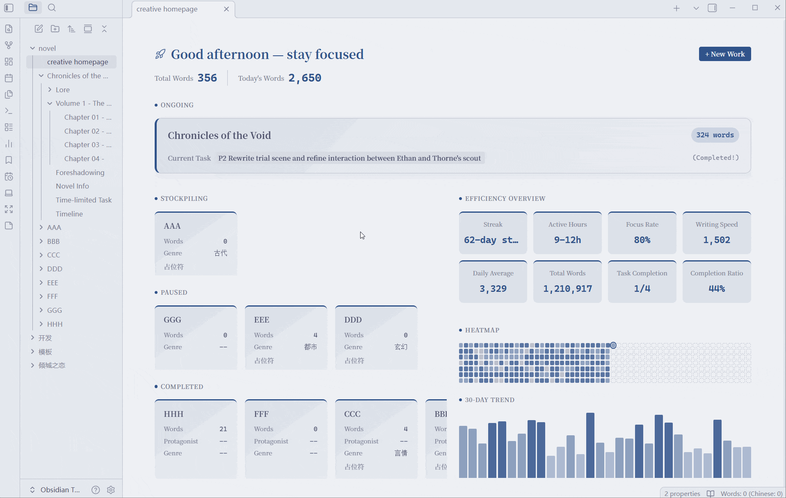

### 🗂️ Writing Workbench
All Chapters Panel · Timeline Board · Foreshadowing Board · Lore Board · Task Board · Writing Journey 
Show only the boards you need. Writing Journey records work and chapter changes with filtering, sorting, navigation, and chapter-status word-count snapshots; history from before recording began is not backfilled

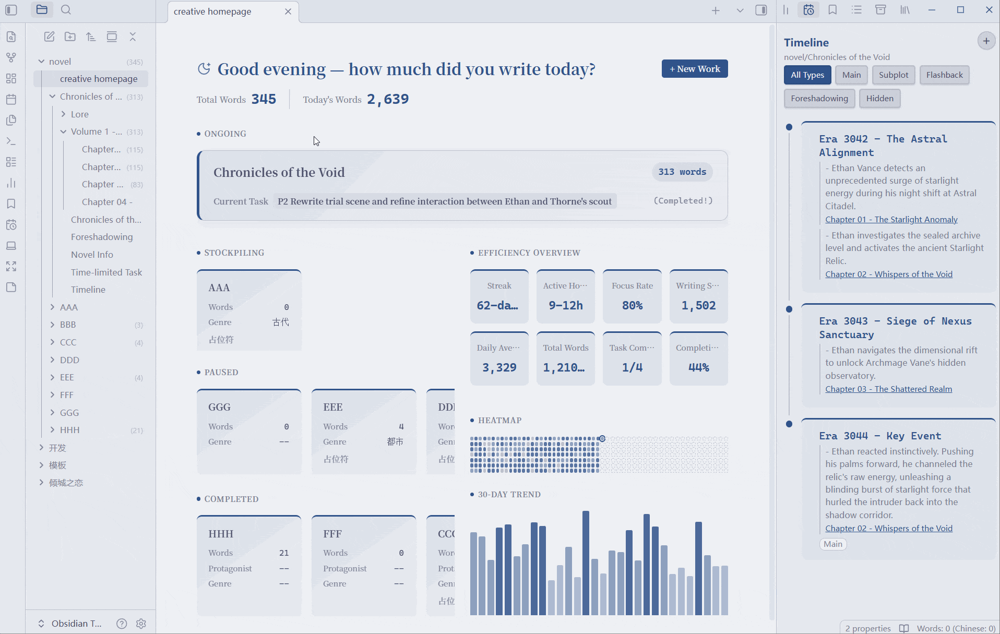

### 🌑 Immersive Writing Mode
Desktop fullscreen focus · Typewriter scroll & line dimming · Configurable dashboard · Four auxiliary regions & reference documents 
Manuscript mode lets you browse chapters continuously, click a passage to continue in the native editor, and resume cursor and reading positions per work; the chapter status panel keeps chapter details within reach for viewing and editing

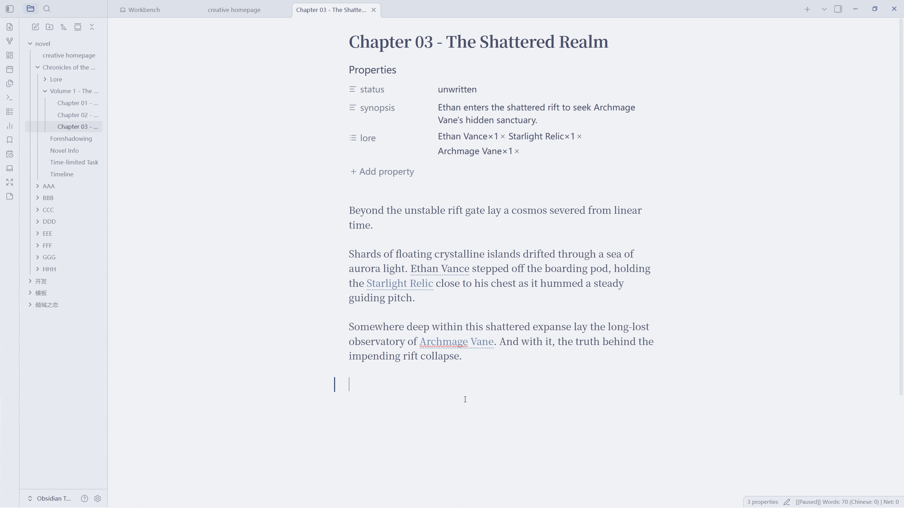

### 📊 Word Count & Goals
3 Counting Modes · Multi-direction Goal Tracking · Strict Chapter Mode · Selection Count Tooltip · Chapter Exclusion · Folder Word Counts

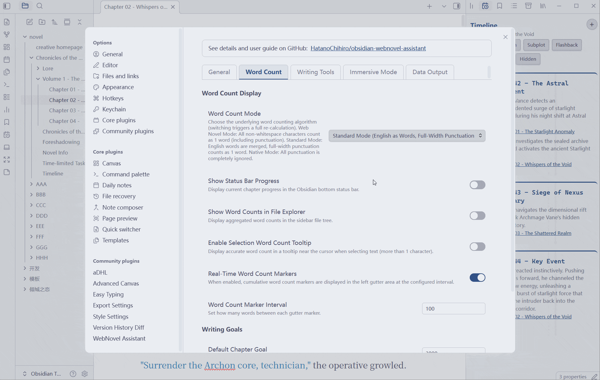

### ⏱️ Focus Time Tracking
Workspace-aware focus/slack tracking · Heatmap & writing trends · Efficiency statistics · Daily active hours & writing-speed details

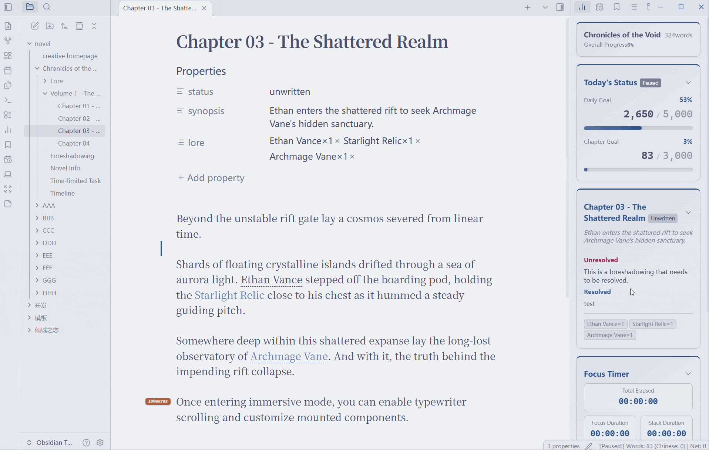

### 🕰️ Chapter Snapshots & Replay
Compare the current draft with local Obsidian File Recovery snapshots · Step through versions at 1x / 3x / 5x · Pause replay to export the full Markdown text or restore the selected snapshot after confirmation and backup 
Requires the File Recovery core plugin; snapshots have device-local retention, do not sync with plugin data, and are not a complete keystroke history

### 🔍 Proofreading
Fully local inline diagnostics · Typos & sensitive words · Synonym consistency · Text-aware Chinese/English punctuation · Optional De/Di/De rules · Review cards & confirmed one-at-a-time replacement · Per-occurrence/whole-word dismissal and ignored-item recovery

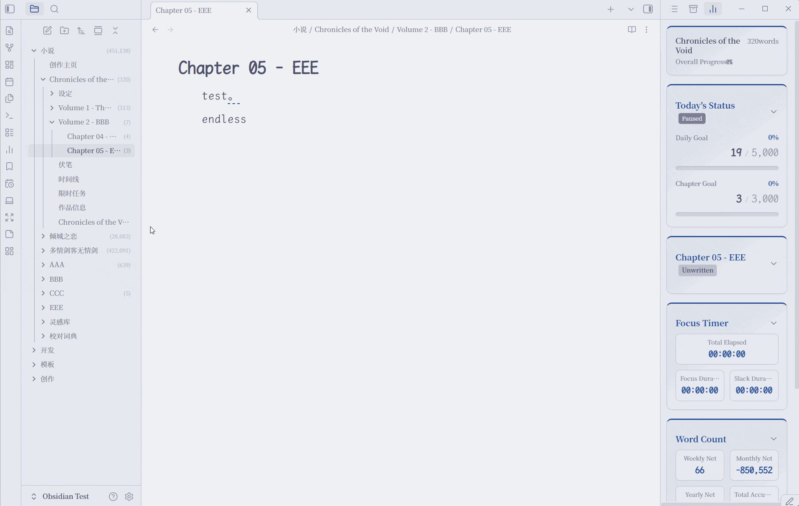

### 📝 Creative Assistants

<table>
<tr>
<td width="33%" align="center" valign="top">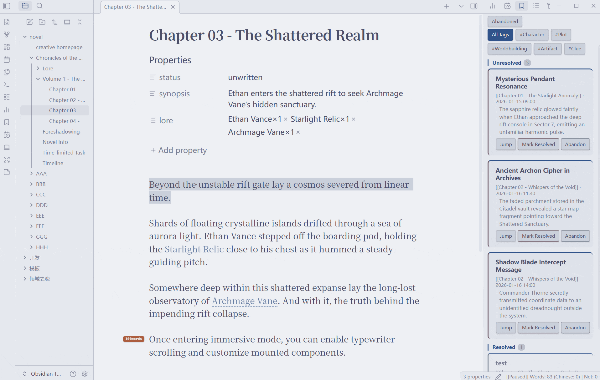 <b>Foreshadowing Manager</b> Mark → Multi-stage tracking → Final resolution</td>
<td width="33%" align="center" valign="top">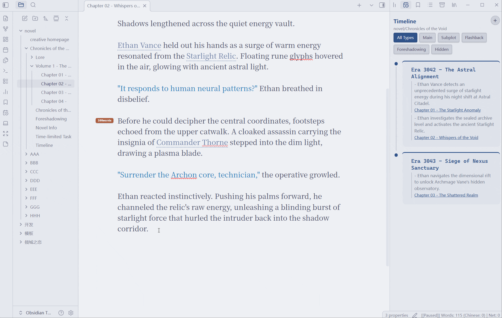 <b>Timeline System</b> Events, multi-chapter links, custom types</td>
<td width="33%" align="center" valign="top">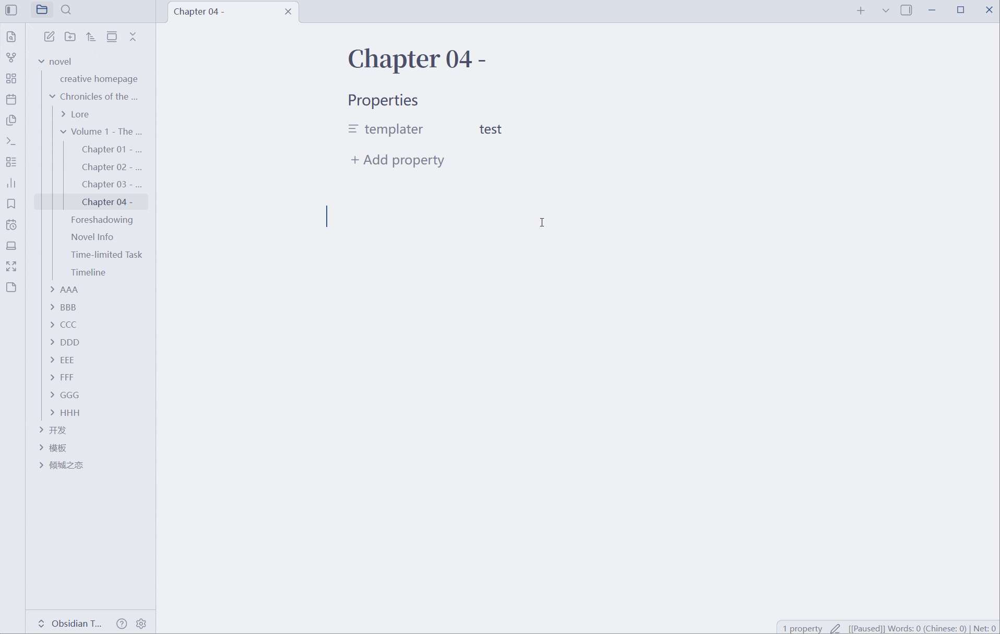 <b>Chapter Corkboard</b> Card overview, status & synopsis editing</td>
</tr>
<tr>
<td width="33%" align="center" valign="top">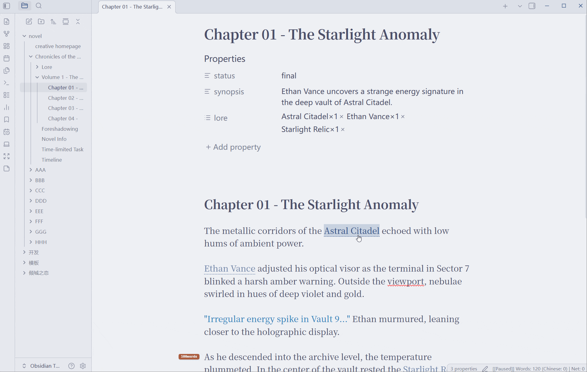 <b>Lore Quick Lookup</b> Nested folders, file entries, auto-highlights & relation graph</td>
<td width="33%" align="center" valign="top">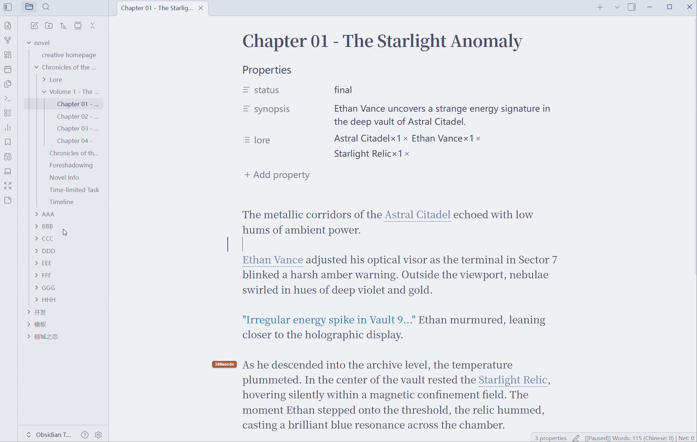 <b>Sticky Notes</b> Auto-save, Markdown render</td>
<td width="33%" align="center" valign="top">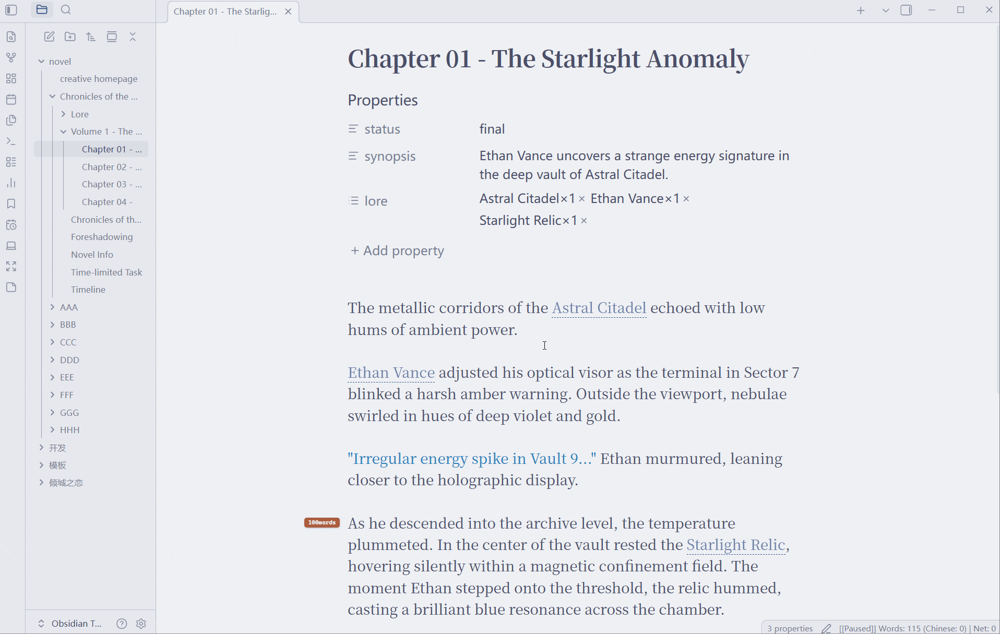 <b>Task Tracker</b> Create periodic tasks, self-driven deadlines & voluntary abandon</td>
</tr>
<tr>
<td width="33%" align="center" valign="top"> <b>Advanced Search</b> Search by book, global or custom scope</td>
<td width="33%" align="center" valign="top">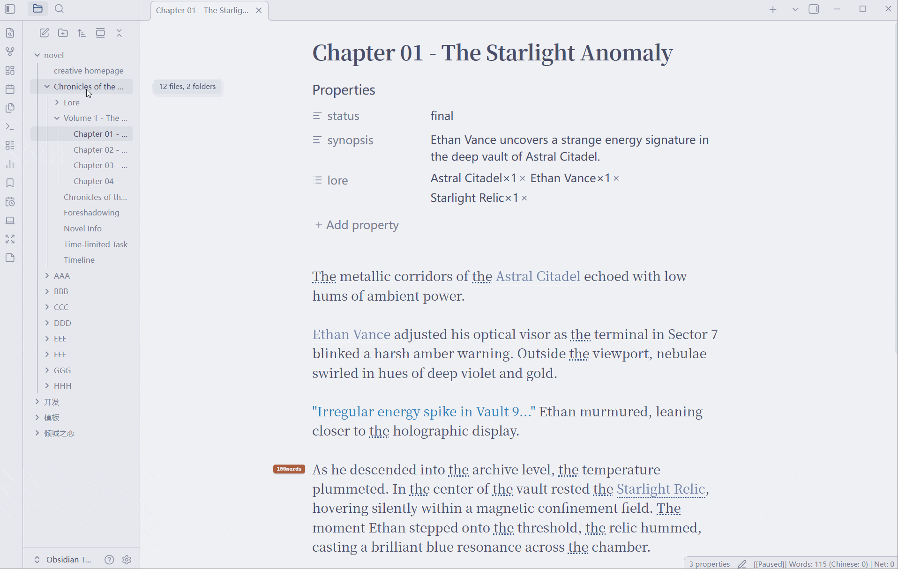 <b>Merge Chapters</b> Desktop preview & revision · Mobile preview & export</td>
<td width="33%" align="center" valign="top">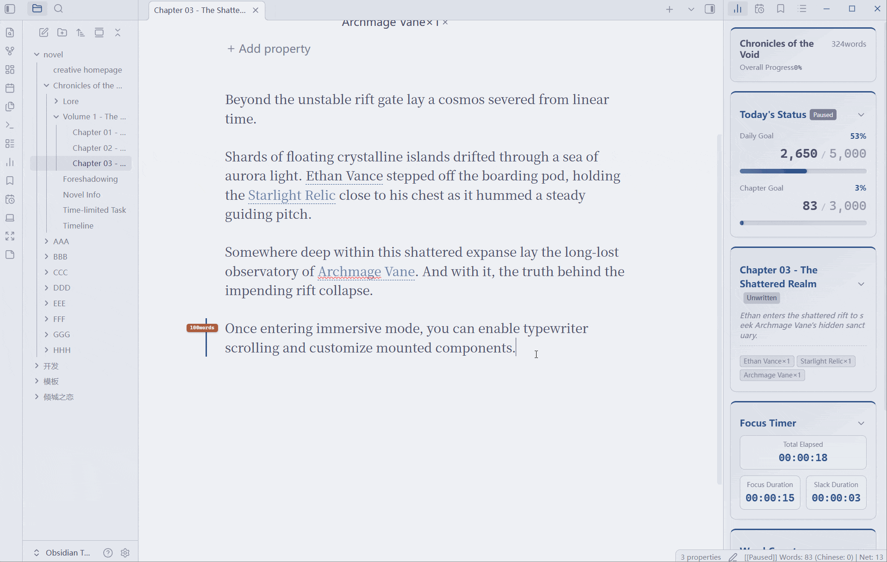 <b>Smart Chapter Creation & Split</b> Smart increment · Cursor split · Chapter templates</td>
</tr>
</table>

### 🎥 OBS Streaming Overlay & 📱 Mobile

| 🎥 OBS Overlay | 📱 Mobile |
|:---|:---|
| Real-time writing stats in OBS | Floating word count & focus timer widget |
| Custom style, opacity & content | Edge docking & auto-collapse handle |
| Local HTTP data, without intermediate statistics files | **Copy Document Pure Text** — available on all platforms, useful for long documents on mobile |

 

## 📥 Installation

Requires Obsidian 1.8.7 or later.

| Method | Steps |
|:-------|:------|
| **Community Plugins** *(Recommended)* | Settings → Community Plugins → Browse → Search **"WebNovel Assistant"** → Install → Enable |
| **BRAT** | Install [BRAT](https://github.com/TfTHacker/obsidian42-brat) → Add repo `HatanoChihiro/obsidian-webnovel-assistant` → Enable |
| **Manual** | Download `main.js`, `manifest.json`, and `styles.css` from the same [Release](https://github.com/HatanoChihiro/obsidian-webnovel-assistant/releases) → Place in `.obsidian/plugins/web-novel-assistant/` → Reload and enable |

## 🚀 Quick Start

1. **Choose the workspace**: For a library under `Novels/`, enter that parent directory in Workspace Folders, one directory per line. Leave empty for vault-wide use.
2. **Prepare a work**: Right-click the first workspace folder to create or import a work. For existing works, open a chapter and follow the guide to configure Novel Info and lore.
3. **Start writing**: View word counts in the desktop status bar, run **Set Chapter Word Count Goal**, and open the **Writing Workbench** to manage chapters and references.
4. **Enable what you need**: Typography, proofreading, ordinary-editor typewriter scrolling, and the mobile floating widget are off by default. Find options with settings search; desktop users can also enter Immersive Mode.

<kbd>🎯 Key Commands</kbd>

| Command | Description |
|---------|-------------|
| Toggle Immersive Writing Mode | Full-screen distraction-free writing |
| Toggle Writing Status Panel | Detailed stats & history charts |
| Toggle Foreshadowing Panel | Manage foreshadowing & recovery |
| Toggle Timeline Panel | Manage story timeline |
| Toggle Writing Workbench View | Chapters, timeline, foreshadowing, lore, task, and Writing Journey boards |
| Open Chapter Overview | Card-style chapter overview |
| Start/Pause Focus Time Tracking | Toggle focus/slack tracking |
| Mark as Foreshadowing | Mark selected text as foreshadowing |
| Create Blank Sticky Note | New floating sticky note |
| Advanced Search | Search by book/global/custom scope |
| Create Next Chapter (Smart Increment) | Smart chapter numbering |
| Split Chapter at Cursor | Move the text after the cursor into a template-based new chapter |
| Compare Current Chapter with Snapshot | View local versions, differences, and replay |
| Toggle Ordinary Editor Typewriter Scrolling | Toggle centered scrolling and unfocused-line dimming in the ordinary editor |
| Rebuild Lore Cache | Rebuild lore entries and chapter reference statistics |
| Annotate to Dictionary | Add selected text from any Markdown document to a custom dictionary |

> All commands can get custom shortcuts in **Settings → Hotkeys**

> Need setup details or troubleshooting? See the full [User Guide](doc/USER_GUIDE_EN.md) / [使用指南](doc/USER_GUIDE.md).

<kbd>⚙️ Key Settings</kbd>

| Setting | Default | Description |
|---------|---------|-------------|
| Language | Auto | UI language — auto-detects Obsidian locale |
| Default Chapter Goal | 3000 | Chapter word goal for new files |
| Daily Goal | 5000 | Daily writing target |
| Show Status Bar Progress | Off | Show chapter goal progress in the desktop status bar |
| Show Word Counts in File Explorer | Off | Folder word counts in sidebar |
| Smart Chapter Sorting | Off | Auto-sort by chapter numbers |
| Workbench View Visibility | All shown | Show or hide any of the six Workbench boards |
| Typewriter Mode (Ordinary Editor) | Off | Independent center offset and unfocused-line opacity |
| Manuscript Mode (desktop) | Off | Browse and switch chapters continuously in Immersive Mode |
| Typography / Proofreading | Off | Enable by scope; official proofreading dictionaries require manual download |
| Eye Care Mode | Off | Warm background color |
| Foreshadowing Filename | `Foreshadowing` | Customizable per workspace |
| Timeline Filename | `Timeline` | Customizable per workspace |
| Timed Task Filename | `Timed Task` | Customizable per workspace |
| Lore Folder Name | `Lore` | Supports dictionary outline mode |
| Word Count Mode | Standard | Standard / Web Novel / Native algorithm |

<kbd>🎨 OBS Overlay Setup</kbd>

1. Plugin settings → Enable **OBS Overlay**
2. OBS → Add **Browser Source** → URL `http://127.0.0.1:24816/`
3. Start with **400×700px**, adjust for enabled items, and refresh the browser source after changing styles

See [OBS Overlay CSS Guide](doc/OBS_OVERLAY_CSS_GUIDE_EN.md) for full customization.

 

## 🌐 Network Use Disclosure

Proofreading and note analysis run locally, without automatic dictionary downloads from external servers. The basic typo dictionary and De/Di/De grammar dictionary are not bundled and require manual download in Settings on first use. Only when you explicitly click **Update Basic Dictionary** or **Update Grammar Dictionary** does it use Obsidian's `requestUrl` API to download public JSON dictionaries from `raw.githubusercontent.com/HatanoChihiro/obsidian-webnovel-assistant`. No note content, vault path, device identifier, account data, or telemetry is uploaded. Responses are strictly validated as dictionary data, cached as JSON, and never executed as code or used to update the plugin or its dependencies.

When the OBS overlay is enabled, its browser source polls the local statistics endpoint at `127.0.0.1`. Custom CSS that references remote images or fonts may also make the browser source contact those addresses. Settings, writing statistics, and sticky notes are stored in `data.json`; Writing Journey is stored in Novel Info, while native snapshots stay on the current device. See the [User Guide](doc/USER_GUIDE_EN.md#back-up-and-restore-history-data-desktop) for backup and sync scope.

 

## 📄 License & 💬 Feedback

[MIT License](LICENSE)

⭐ Star · 🐛 [Issues](https://github.com/HatanoChihiro/obsidian-webnovel-assistant/issues) · 💡 [Discussions & Feature Requests](https://github.com/HatanoChihiro/obsidian-webnovel-assistant/discussions)

 

**Happy writing!** ✍️

